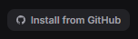
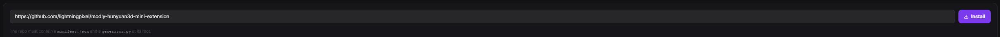
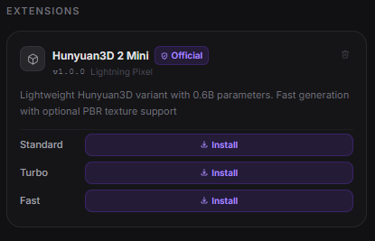

```bash
# Windows
launch.bat

# Linux / macOS
./launch.sh
```

---


## Getting started

### 1. Install JS dependencies

```bash
npm install
```

### 2. Set up Python backend

```bash
cd api
python -m venv .venv
.venv\Scripts\activate     # Windows
source .venv/bin/activate  # Linux / macOS
pip install -r requirements.txt
```

### 3. Run in development

```bash
npm run dev
```

### 4. Test

```bash
npm test
./node_modules/.bin/tsc --noEmit -p tsconfig.node.json
npm run build
```

## Platform notes

- AMD GPUs are supported through ROCm on Linux and Windows: a Radeon card is detected
  automatically and extensions are steered to ROCm PyTorch wheels, with no ROCm install
  required. See [docs/running-on-amd-rocm.md](docs/running-on-amd-rocm.md).
- macOS support targets Apple Silicon only.
- macOS uses native window controls. Windows and Linux keep the existing custom controls.
- The top bar includes a live RAM indicator sourced from the main process.
- Workflow wiring is validated before run; invalid graphs stay in place and surface inline/toast warnings instead of dropping the current mesh view.
- Package Apple Silicon macOS with `npm run package:mac`.
- Imported meshes can be smoothed and decimated in-app; optimized results are written back into the workspace.

---

## Extension system

NOVA supports external model and process extensions. Each extension is a GitHub repository containing a `manifest.json` plus the runtime entry files required by its type.

### Official extensions

| Model | URL |
|-------|-----|
| Hunyuan3D 2 Mini | https://github.com/lightningpixel/modly-hunyuan3d-mini-extension |
| Hunyuan3D 2 Mini Turbo | https://github.com/lightningpixel/modly-hunyuan3d-mini-turbo-extension |
| Hunyuan3D 2 Mini Fast | https://github.com/lightningpixel/modly-hunyuan3d-mini-fast-extension |
| TripoSG | https://github.com/lightningpixel/modly-triposg-extension |
| Trellis2 GGUF | https://github.com/lightningpixel/modly-trellis2-gguf-extension |

### How to install an extension

**1.** Go to the **Models** page and click **Install from GitHub**.



**2.** Enter the HTTPS URL of the extension repository and confirm.



**3.** If the extension exposes model nodes, download the model or one of its variants. Process extensions are ready once installation and setup complete.



### Multiple Hugging Face repositories per model node

A model node whose weights are split across repositories can declare
`model_sources`. Modly validates every source, downloads them sequentially in
one Models-page action, and considers the node installed only when every
declared check exists.
